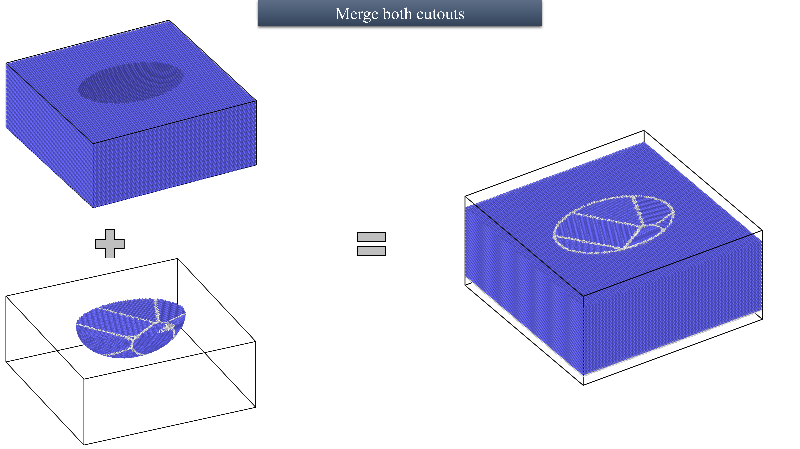

# GrainGenMD

**GrainGenMD** is a versatile toolkit designed to assist researchers in generating, processing, and visualizing polycrystalline structures for molecular dynamics (MD) simulations. This repository provides scripts to create grain configurations, filter atomic data, and prepare simulation-ready input files compatible with tools like Atomsk and LAMMPS.

---

## Features
- **Grain Generation**: Generate Atomsk-compatible grain structures for polycrystalline systems.
- **Geometric Filtering**: Filter atoms within or outside user-defined geometric regions (e.g., ellipsoids).
- **Structure Merging**: Combine bulk and polycrystalline regions for MD simulations.
- **Visualization**: Create 2D/3D visualizations of grain distributions and atomic positions.
- **Flexible Inputs**: Customizable lattice type, lattice parameters, orientations, grain configurations, and box dimensions.
- **Simulation Compatibility**: Generate `.xsf` and `.data` files for Atomsk and LAMMPS.

---

## Getting Started

### Prerequisites
1. **Python 3.6+**
   - Required libraries: `numpy`, `matplotlib`
   - Install dependencies:  
     ```bash
     pip install numpy matplotlib
     ```
2. **Atomsk**
   - Download from [Atomsk official site](https://atomsk.univ-lille.fr).
3. **LAMMPS** (optional)
   - Ensure compatibility with the generated `.data` files.

### Installation
Clone the repository:
```bash
git clone https://github.com/your-username/GrainGenMD.git
cd GrainGenMD
```
Run the script:
```bash
cd ./src/
bash main.bash
```
View the generated LAMMPS-compatible input file:
```bash
cd ./<new_directory_will_be_generated> 
less final_<some_random_number>.data
```
---

## Sample File:

Below is an example of a 3D grain distribution generated using the tool:




contact at afnanmostafa102@gmail.com for queries.
